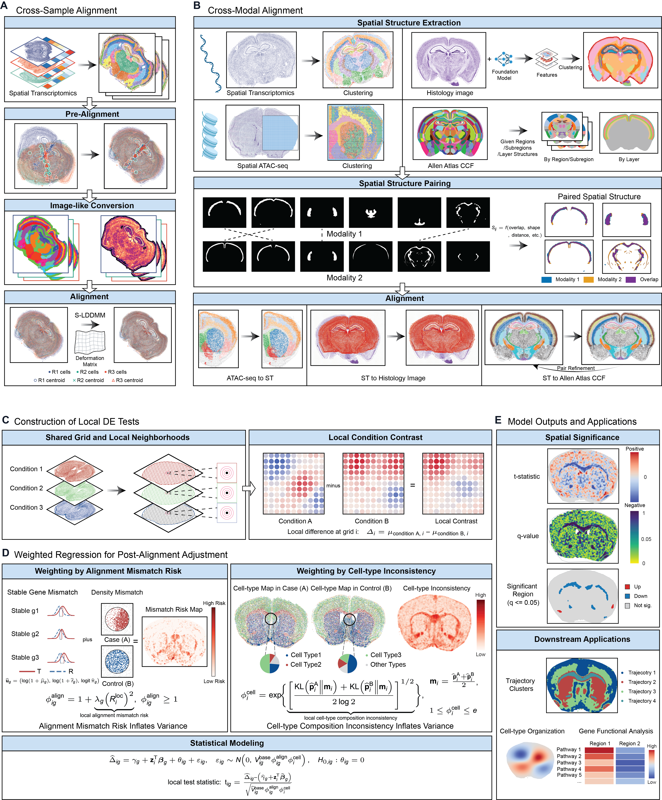

# spAlignDE

**spAlignDE** uses tissue structure to align spatial omics datasets across
samples and modalities. For aligned spatial transcriptomics samples, it tests
local differences in gene expression while accounting for residual alignment
mismatch.

It supports alignment between tissue sections, registration with histology
images and anatomical atlases, spatial ATAC-seq to spatial transcriptomics
alignment, and interactive region pairing.

[Documentation](https://dsong-lab.github.io/spAlignDE/)

<p align="center">
  <a href="assets/Figure_1_spAlignDE.png">
    
  </a>
</p>

## Installation

Install spAlignDE and its dependencies with Conda. The supplied environment
uses CUDA 12.8; for a CPU-only setup, follow the
[installation guide](https://dsong-lab.github.io/spAlignDE/installation.html#gpu-and-cpu-variants)
before creating the environment.

```bash
git clone https://github.com/dsong-lab/spAlignDE.git
cd spAlignDE
conda env create -f environment.yml
conda activate spAlignDE-notebooks
python -m pip install --no-deps --no-build-isolation -e .
python -m ipykernel install --user \
  --name spAlignDE-notebooks \
  --display-name "Python (spAlignDE-notebooks)"
```

Select **Python (spAlignDE-notebooks)** as the Jupyter kernel.

## Quick Start

This synthetic example runs on the CPU with two optimization iterations.
See the tutorials below for real-data analyses.

```python
import spAlignDE

spAlignDE.set_random_seed(0)
adata = spAlignDE.make_cross_sample_example(n_per_cluster=10, random_state=0)

result = spAlignDE.align_cross_sample(
    adata,
    query_sample="query",
    reference_sample="reference",
    rasterization_config=spAlignDE.RasterizationConfig(grid_spacing=0.3),
    slddmm_config=spAlignDE.SLDDMMConfig(
        iterations=2,
        kernel_scale=1.0,
        velocity_grid_spacing=0.5,
        momentum_lr=1.0,
        minimum_momentum_lr=1.0,
        sigma_regularization=100.0,
    ),
    device="cpu",
    verbose=False,
    return_result=True,
)
result.adata.write_h5ad("cross_sample_example_aligned.h5ad")
print(result.metrics)
```

The example saves aligned data to `cross_sample_example_aligned.h5ad`.
The [Python API](https://dsong-lab.github.io/spAlignDE/api.html) describes the
available functions and output fields.

## Tutorials

See the [tutorial guide](https://dsong-lab.github.io/spAlignDE/tutorial.html)
and [notebooks](https://dsong-lab.github.io/spAlignDE/source_notebooks.html)
for detailed examples:

- [Cross-sample alignment](https://dsong-lab.github.io/spAlignDE/tutorials/cross_sample_alignment.html)
- [Allen brain atlas alignment](https://dsong-lab.github.io/spAlignDE/tutorials/cross_modality_atlas_alignment.html)
- [Histology image alignment](https://dsong-lab.github.io/spAlignDE/tutorials/st_histology_image_processing.html)
- [Spatial ATAC-seq to spatial transcriptomics alignment](https://dsong-lab.github.io/spAlignDE/tutorials/cross_modality_atac_alignment.html)
- [Alignment stability](https://dsong-lab.github.io/spAlignDE/source_notebooks/cross_sample_uncertainty_qualification.html)
- [Local differential expression](https://dsong-lab.github.io/spAlignDE/tutorials/post_alignment_inference.html)

## Citation

If you use **spAlignDE** in your research, please cite our preprint:

Xu, S., Wang, Y., Meng, L., Dalal, A., Yin, Y., & Song, D. (2026). **spAlignDE unifies cross-sample and cross-modal spatial alignment with mismatch-aware differential expression.** *bioRxiv*. [doi:10.64898/2026.09.05.749632](https://doi.org/10.64898/2026.09.05.749632)

## License

spAlignDE is released under the [MIT License](LICENSE).
